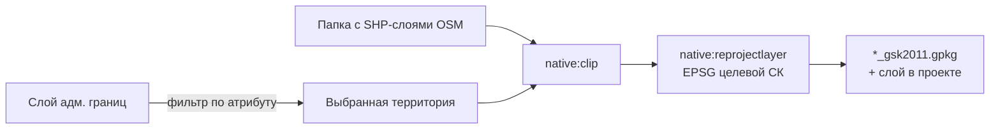

<div align="center">


# Clip Reproject

**Плагин QGIS для обрезки и перепроецирования векторных данных OpenStreetMap**

[](../../actions/workflows/main.yml)


</div>

---

## О плагине

**Clip Reproject** помогает подготовить набор пространственных данных OpenStreetMap для конкретной территории. За один запуск плагин:

1. **Выбирает территорию** в слое административных границ по значению атрибута.
2. **Обрезает** все SHP-слои из указанной папки по выбранной границе.
3. **Перепроецирует** результат в заданную систему координат (например, зону ГСК-2011).
4. **Сохраняет** слои в GeoPackage и сразу добавляет их в текущий проект QGIS.

## Как это работает



Обрезанный слой хранится во временном слое в памяти, поэтому в папке результата появляются только итоговые файлы. При повторном запуске старые результаты перезаписываются, а их слои в проекте заменяются новыми, без дублей.

## Установка

### Windows

1. **Скачайте плагин.** На странице репозитория нажмите **Code → Download ZIP** и распакуйте архив. Внутри будет папка `clip_reproject-main`: переименуйте её в **`clip_reproject`**.

2. **Откройте папку плагинов QGIS.** Нажмите `Win + R`, вставьте путь и нажмите Enter:
   ```
   %APPDATA%\QGIS\QGIS3\profiles\default\python\plugins
   ```
   Если папки `plugins` нет, создайте её. Для профиля QGIS с другим именем замените `default` на него. Папку активного профиля можно открыть и из QGIS: **Установки → Профили пользователей → Открыть папку активного профиля**, затем перейти в `python\plugins`.

3. **Скопируйте плагин.** Положите папку `clip_reproject` в `plugins`. Файлы плагина должны лежать прямо в ней:
   ```
   ...\python\plugins\clip_reproject\__init__.py
   ...\python\plugins\clip_reproject\metadata.txt
   ...
   ```
   > [!WARNING]
   > Проверьте, что не получилось вложенной папки вида `clip_reproject\clip_reproject-main\...`. С такой структурой QGIS плагин не найдёт.

4. **Включите плагин.** Перезапустите QGIS, откройте **Модули → Управление модулями → Установленные** и отметьте **Clip Reproject**.

### Linux и macOS

Скачайте или клонируйте репозиторий и скопируйте папку `clip_reproject` в каталог плагинов QGIS (или выполните `make deploy`, см. [Разработка](#разработка)):

| ОС | Каталог плагинов |
|----|------|
| Linux | `~/.local/share/QGIS/QGIS3/profiles/default/python/plugins/` |
| macOS | `~/Library/Application Support/QGIS/QGIS3/profiles/default/python/plugins/` |

Затем перезапустите QGIS и включите плагин в **Модули → Управление модулями → Установленные**.

### После установки

На панели инструментов появится иконка плагина, а в меню **Модули** — пункт **Clip Reproject**.

Если плагина нет в списке установленных:
- проверьте структуру папок (см. шаг 3 для Windows);
- откройте **Вид → Панели → Журнал сообщений**: ошибки загрузки будут на вкладке *Python* или *Clip Reproject*.

## Использование

Откройте плагин и заполните поля диалога:

| Поле | Обязательное | Описание |
|------|:---:|----------|
| **Путь к SHP файлам** | ✅ | Папка с исходными слоями OSM (`.shp`) |
| **Путь к файлу с границей области** | ✅ | Shapefile с административными границами |
| **Атрибут фильтра** | — | Имя поля, по которому выбирается территория, например `name` |
| **Значение фильтра** | — | Значение этого поля, например `Тверская область` |
| **EPSG-код ГСК-2011** | ✅ | Код целевой системы координат (целое число) |
| **Папка для сохранения результата** | ✅ | Куда сохранить итоговые слои; создаётся, если её нет |

> [!NOTE]
> Атрибут и значение фильтра заполняются **вместе**. Если оба поля пустые, обрезка выполняется по всем объектам слоя границ.

Нажмите **OK** — плагин обработает все слои и сообщит, сколько из них было обработано.

### Результат

Для каждого входного слоя `<имя>.shp` создаётся файл:

```
<папка результата>/<имя>_gsk2011.gpkg
```

Например, `roads.shp` → `roads_gsk2011.gpkg`. Все итоговые слои автоматически добавляются на карту.

## Проверка ввода и обработка ошибок

Плагин проверяет данные **до** запуска обработки и не закрывает диалог, пока ошибки не исправлены:

- заполнены ли обязательные поля;
- существуют ли папка с данными и файл границ;
- является ли EPSG-код целым числом и корректной системой координат;
- есть ли указанный атрибут в слое границ и найдена ли по нему территория;
- не указывает ли путь результата на файл вместо папки.

Ход работы и ошибки пишутся в **Журнал сообщений QGIS** на вкладку **Clip Reproject**. Непредвиденные ошибки сохраняются там с полным трейсбеком.

## Структура проекта

```
clip_reproject/
├── __init__.py                  # Точка входа плагина (classFactory)
├── clip_reproject.py            # Интеграция с интерфейсом QGIS: меню, кнопка, запуск
├── clip_reproject_dialog.py     # Диалог и проверка введённых данных
├── clip_reproject_dialog_base.ui# Разметка диалога (Qt Designer)
├── processor.py                 # Геообработка: выбор, обрезка, перепроецирование
├── error_handling.py            # Логирование и сообщения об ошибках
├── metadata.txt                 # Метаданные плагина для QGIS
├── icon.png                     # Иконка
├── test/                        # Тесты
└── .github/workflows/main.yml   # CI: проверка кода через ruff
```

## Разработка

Стиль кода проверяется с помощью [ruff](https://docs.astral.sh/ruff/) — те же проверки запускаются в GitHub Actions при каждом push и pull request:

```bash
pip install ruff
ruff check .
ruff format --check .
```

Настройки линтера находятся в [pyproject.toml](pyproject.toml).

Установка плагина в QGIS из исходников. Путь к каталогу плагинов вычисляется по ОС, при необходимости его можно переопределить:

```bash
make deploy                          # профиль default
make deploy QGIS_PROFILE=work        # другой профиль QGIS
make deploy QGISDIR=/path/to/plugins # произвольный каталог
```

> [!NOTE]
> Для `make deploy` нужны GNU make, Unix-утилиты (`cp`, `mkdir`; на Windows — например, Git Bash) и Sphinx для сборки справки (`pip install sphinx`).

Тесты запускаются в окружении с установленным QGIS:

```bash
make test
```

## Автор

**KalmikovStepan** — [kalmykovstepan4@gmail.com](mailto:kalmykovstepan4@gmail.com)

## Лицензия

Распространяется под лицензией **GNU GPL v2** или более поздней версии.
